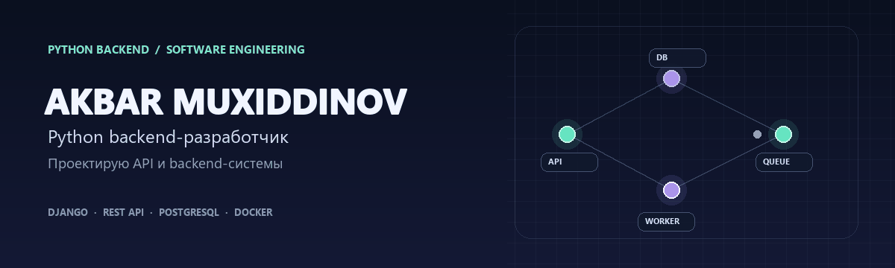

<div align="center">
  
  <br>
  <a href="https://github.com/AkbarxojaMuxiddinov"></a>
  
  
  
</div>

<h1 align="center">Привет! Я Акбар Мухиддинов 👋</h1>

<p align="center">
  Python backend-разработчик и Software Engineer .<br>
  Создаю API и серверные приложения на Python и Django.
</p>

## Что мне интересно

```text
  запрос клиента
       │
       ▼
  Django REST API ─── JWT и роли
       │
       ├──────────── PostgreSQL / SQLite
       ├──────────── Redis / Celery
       └──────────── Docker Compose
```

- Проектирование REST API и понятных контрактов между сервисами
- Аутентификация, роли и разграничение доступа
- Работа с реляционными моделями и транзакциями
- Фоновые задачи и контейнеризация приложений

## Проекты

| Проект | Что внутри |
|---|---|
| [B2B CRM & HR Management API](https://github.com/AkbarxojaMuxiddinov/B2B-CRM-HR-Management-API) | Сотрудники, отделы, посещаемость, роли, JWT, расчёт зарплат с Celery и Redis; запуск через Docker Compose |
| [Hospital Dispatch API](https://github.com/AkbarxojaMuxiddinov/hospital-dispatch-api) | Больницы, машины скорой помощи, экстренные вызовы и назначение доступной машины |
| [Django FinTech API](https://github.com/AkbarxojaMuxiddinov/django-fintech-api) | Пользовательские кошельки, пополнение баланса и переводы между счетами |
| [Django E-Commerce API](https://github.com/AkbarxojaMuxiddinov/django-ecommerce-api) | Каталог, персональная корзина, оформление заказа и складские остатки |
| [Marketing Agency Backend](https://github.com/AkbarxojaMuxiddinov/marketing-agency-backend) | Услуги агентства, портфолио, клиенты, социальные ссылки и входящие заявки |

## Мой GitHub в движении

Каждый день GitHub Actions строит анимированную змейку по графику моих вкладов.

<picture>
  <source media="(prefers-color-scheme: dark)" srcset="https://raw.githubusercontent.com/AkbarxojaMuxiddinov/AkbarxojaMuxiddinov/output/github-contribution-grid-snake-dark.svg">
  <source media="(prefers-color-scheme: light)" srcset="https://raw.githubusercontent.com/AkbarxojaMuxiddinov/AkbarxojaMuxiddinov/output/github-contribution-grid-snake.svg">
  
</picture>

## Инструменты

<p>
  
  
  
  
  
  
  
  
  
</p>

## Связаться

- **Локация:** Ташкент, Узбекистан
- **Email:** [akbarxojamuxiddinov8@gmail.com](mailto:akbarxojamuxiddinov8@gmail.com)

<p align="center"><sub>Спасибо, что заглянули в мой профиль ✨</sub></p>
