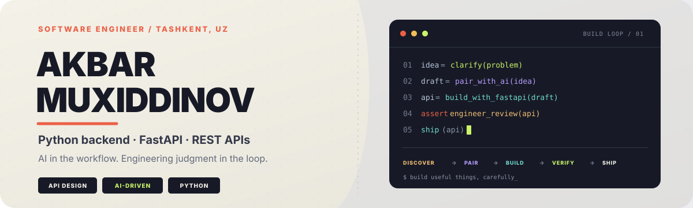

  
    
  
  
  
  
  

<h1 align="center">Привет, я Акбар Мухиддинов 👋</h1>

<h3 align="center">Software Engineer · Python Backend · FastAPI · AI-driven development</h3>

  Проектирую API и backend-системы: от понятных контрактов и надёжной модели данных 
  до фоновых процессов, интеграций и автоматизированных рабочих процессов.

## Чем занимаюсь

- **Backend engineering:** Python, FastAPI, Django и Django REST Framework.
- **API design:** REST API, аутентификация, роли, валидация и интеграции между сервисами.
- **Data & infrastructure:** PostgreSQL, Redis, Celery, Docker и асинхронные задачи.
- **AI-driven development:** использую AI для исследования, декомпозиции задач, прототипирования, рефакторинга и документации; результат проверяю инженерными практиками и тестированием.

## Избранные проекты

| Проект | Что реализовано |
|---|---|
| [Smart HR Telegram Bot](https://github.com/AkbarxojaMuxiddinov/smart-hr-telegram-bot) | FastAPI, aiogram, PostgreSQL, geofencing, роли, задачи и отчёты; Redis и Celery для уведомлений |
| [B2B CRM & HR Management API](https://github.com/AkbarxojaMuxiddinov/B2B-CRM-HR-Management-API) | Сотрудники, отделы, посещаемость, JWT, расчёт зарплат, Celery и Redis |
| [Hospital Dispatch API](https://github.com/AkbarxojaMuxiddinov/hospital-dispatch-api) | Больницы, машины скорой помощи, экстренные вызовы и назначение доступной машины |
| [Django FinTech API](https://github.com/AkbarxojaMuxiddinov/django-fintech-api) | Пользовательские кошельки, пополнение баланса и переводы между счетами |
| [Django E-Commerce API](https://github.com/AkbarxojaMuxiddinov/django-ecommerce-api) | Каталог, корзина, оформление заказов и складские остатки |
| [Marketing Agency Backend](https://github.com/AkbarxojaMuxiddinov/marketing-agency-backend) | Услуги, портфолио, клиенты и входящие заявки |

## Инструменты

  
  
  
  
  
  
  
  
  
  
  
  

## GitHub activity

<picture>
  <source media="(prefers-color-scheme: dark)" srcset="https://raw.githubusercontent.com/AkbarxojaMuxiddinov/AkbarxojaMuxiddinov/output/github-contribution-grid-snake-dark.svg">
  <source media="(prefers-color-scheme: light)" srcset="https://raw.githubusercontent.com/AkbarxojaMuxiddinov/AkbarxojaMuxiddinov/output/github-contribution-grid-snake.svg">
  
</picture>

## Контакты

- **Локация:** Ташкент, Узбекистан
- **Email:** [akbarxojamuxiddinov8@gmail.com](mailto:akbarxojamuxiddinov8@gmail.com)
- **GitHub:** [@AkbarxojaMuxiddinov](https://github.com/AkbarxojaMuxiddinov)

Строю надёжные backend-системы и использую AI как инженерный инструмент — с проверкой, ответственностью и вниманием к деталям. ✨

